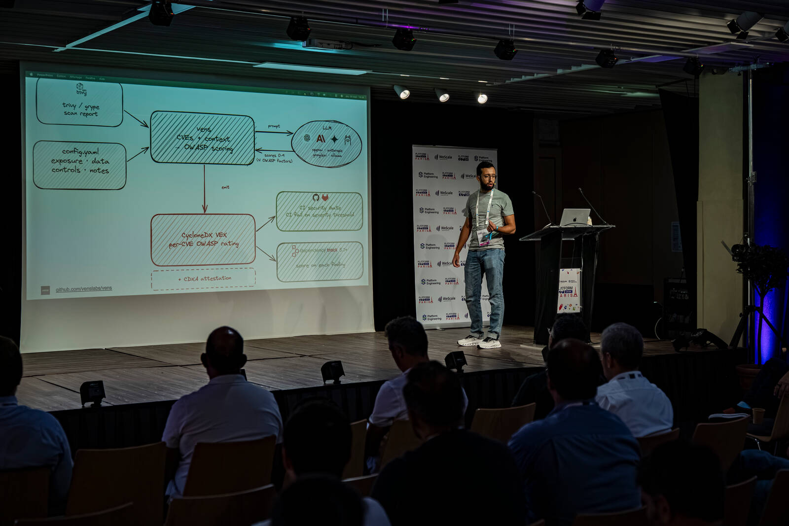
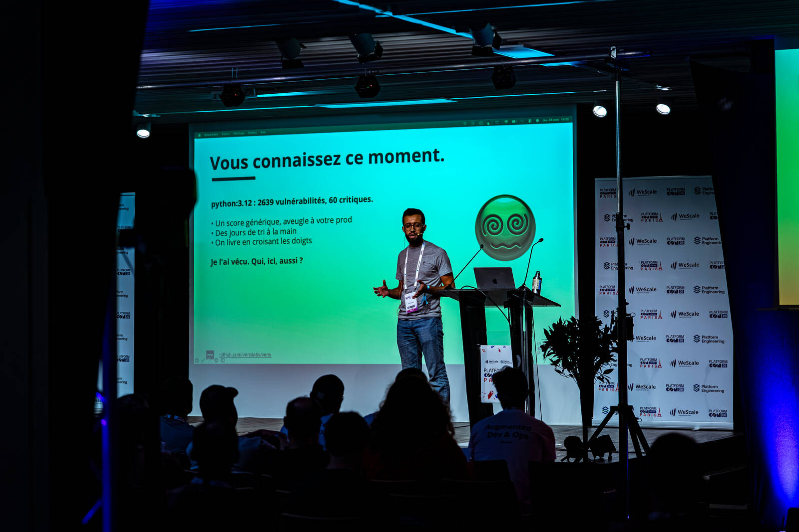
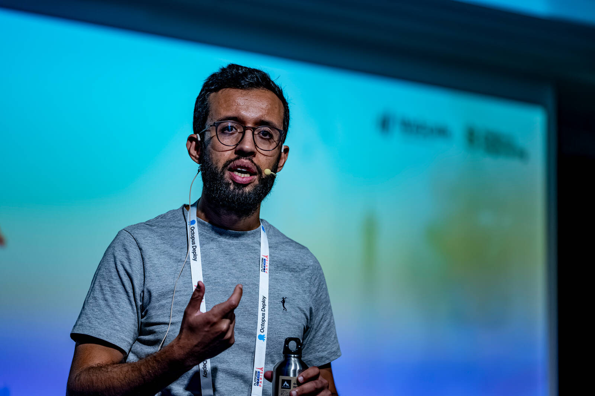
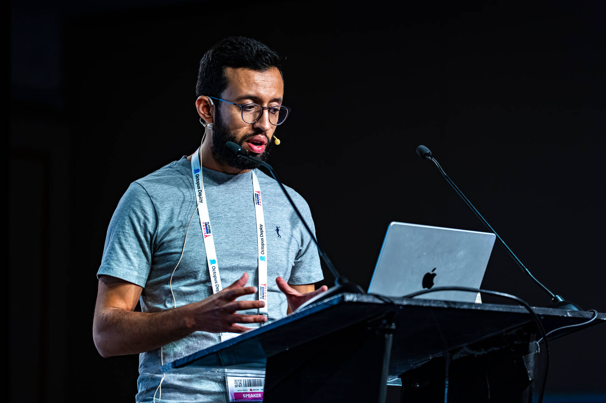

# Talks

Where vens has been presented, and where it is going next.

## Upcoming

| Date | Event | City | Format | Language |
|---|---|---|---|---|
| 2026-11-14 | Capitole du Libre | Toulouse, FR | conference, 55 min | FR |
| 2026-12-09/10 | KCD Suisse Romande | Geneva (CERN), CH | lightning, 5 min | FR |

## Past

| Date | Event | City | Format | Language | Slides | Video |
|---|---|---|---|---|---|---|
| 2026-09-24 | PlatformCon Live Day Paris | Paris, FR | 30 min | FR | [PDF](assets/platformcon-paris-2026.pdf) | |
| 2026-06-25 | SecureChainCon | online | recorded | EN | | [video](https://www.youtube.com/watch?v=Pnx1nqGAeSY) |

## Photos

### PlatformCon Live Day Paris, 2026

<figure markdown>
  
  <figcaption>Presenting the architecture</figcaption>
</figure>

<figure markdown>
  
  <figcaption>On stage</figcaption>
</figure>

<figure markdown>
  
  <figcaption>Mid-explanation</figcaption>
</figure>

<figure markdown>
  
  <figcaption>At the lectern</figcaption>
</figure>

<small>Photos: Jean-Baptiste Poggi, not covered by the vens Apache-2.0 licence.</small>

